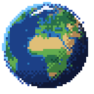
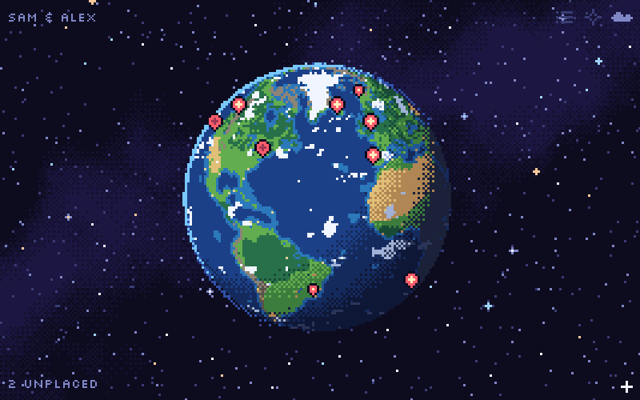
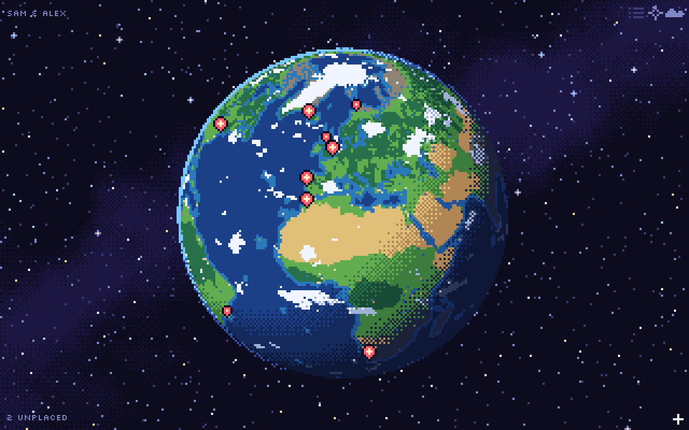
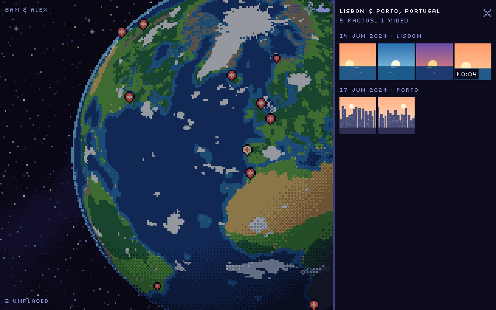
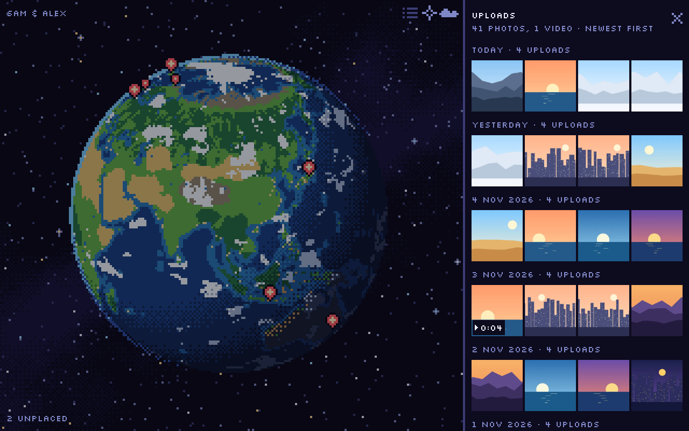
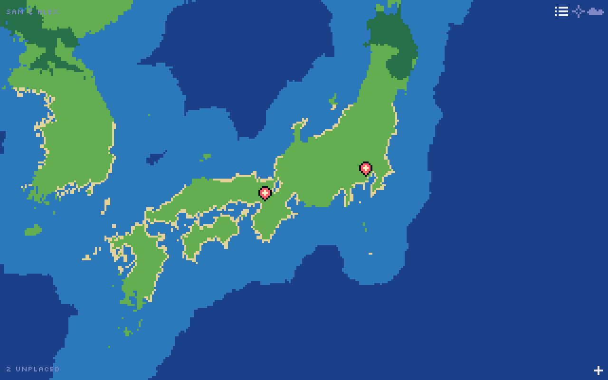
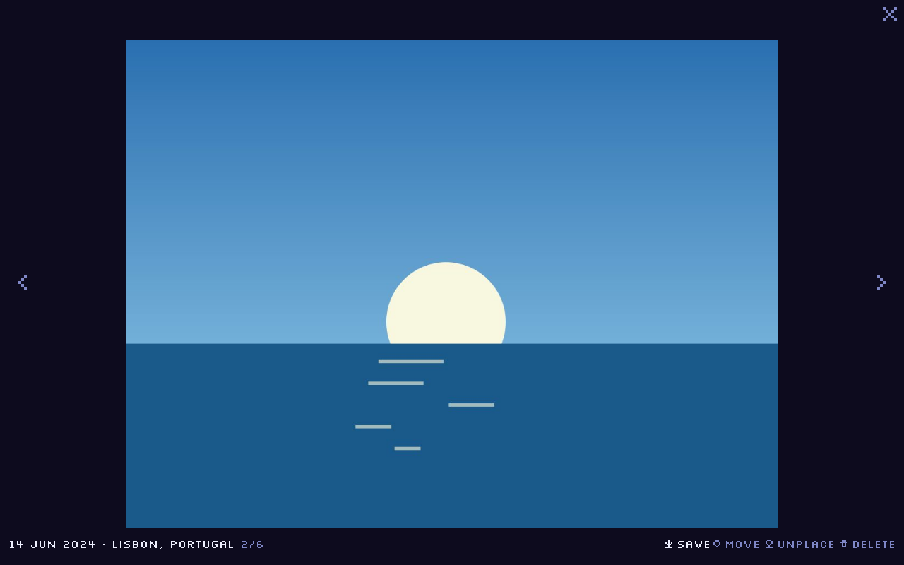
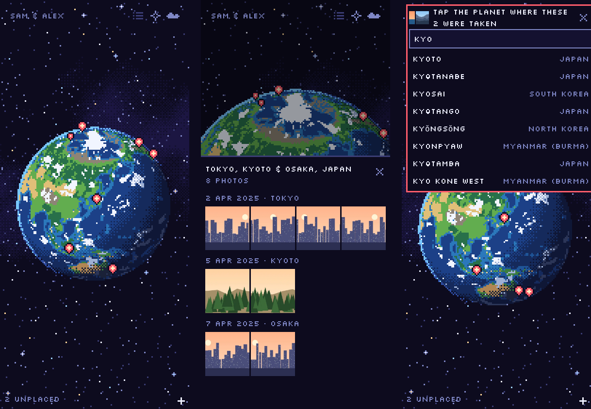

<p align="center">
  
</p>

<h1 align="center">Photo Planet</h1>

<p align="center">
  <strong>Your photos and videos, pinned where they were taken, on a little pixel-art planet you can spin.</strong><br>
  Self-hosted · one Docker container · private by default
</p>

<p align="center">
  <a href="https://github.com/joecrockett5/photo-planet/actions/workflows/ci.yml"></a>
  <a href="https://github.com/joecrockett5/photo-planet/actions/workflows/release.yml"></a>
  <a href="https://github.com/joecrockett5/photo-planet/releases"></a>
  <a href="https://github.com/joecrockett5/photo-planet/pkgs/container/photo-planet"></a>
  
  <a href="LICENSE"></a>
</p>

<p align="center">
  
</p>

---

## Contents

- [Features](#features)
- [Screenshots](#screenshots)
- [Quick start](#quick-start)
- [Configuration](#configuration)
- [Updating and versions](#updating-and-versions)
- [Your data](#your-data)
- [Putting it on the internet](#putting-it-on-the-internet)
- [How it handles media](#how-it-handles-media)
- [Development](#development)
- [License and credits](#license-and-credits)

## Features

- 🌍 **A real little world.** A pixel-art Earth with real coastlines, lakes and
  biomes, dithered day and night, drifting clouds and a twinkling sky. Drag to
  spin (with a Google-Earth-style fling), scroll or pinch to zoom toward a spot,
  close enough that towns 20km apart get their own pins.
- 📍 **Photos place themselves.** Location and date come from the files
  (EXIF for photos, the location tags phones write into videos), and each pin is
  named offline: *"Osaka, Japan"*.
- 📤 **Easy uploads.** The `+` button or drag and drop. JPEG, PNG, HEIC/HEIF,
  WebP, MP4, MOV and WebM. Originals are kept byte-for-byte; duplicates are
  recognised.
- 🖼️ **Browse by place and day.** Tap a pin to fly there and open its photos;
  full-screen viewer with swipe, arrow keys and video playback.
- 🗂️ **Unplaced tray.** Photos without a location wait there: drop them on the
  planet or type a town, several at once. Move, unplace or delete anything.
- 🕒 **Uploads feed.** Everything newest first, by the day it was added.
- 🔒 **Private.** One shared password with long-lived sessions. Nothing is sent
  to third-party services: no external fonts, scripts, maps or geocoding APIs.
- 📱 **Phone-friendly.** Touch gestures, bottom sheets, and it works as a
  home-screen app. Calm by default: motion is reduced until you switch it on.
- 🐳 **One container.** For `linux/amd64` and `linux/arm64` (Raspberry Pi, most
  NAS boxes). All state lives in one volume.

## Screenshots

<table>
  <tr>
    <td width="50%"></td>
    <td width="50%"></td>
  </tr>
  <tr>
    <td align="center">The planet</td>
    <td align="center">Tap a pin: its photos, by day and town</td>
  </tr>
  <tr>
    <td width="50%"></td>
    <td width="50%"></td>
  </tr>
  <tr>
    <td align="center">Uploads feed</td>
    <td align="center">Zoom right in</td>
  </tr>
  <tr>
    <td colspan="2"></td>
  </tr>
  <tr>
    <td colspan="2" align="center">Full-screen viewer</td>
  </tr>
  <tr>
    <td colspan="2"></td>
  </tr>
  <tr>
    <td colspan="2" align="center">On a phone: the planet, a pin's photos, and placing photos by typing a town</td>
  </tr>
</table>

<sub>The photos in these screenshots are generated illustrations.</sub>

## Quick start

All you need is [Docker](https://docs.docker.com/get-docker/). No source
code: the app ships as a ready-made image,
`ghcr.io/joecrockett5/photo-planet`.

**1.** Make a folder with this `docker-compose.yml`:

```yaml
services:
  photo-planet:
    image: ghcr.io/joecrockett5/photo-planet:latest
    restart: unless-stopped
    ports:
      - "8080:3000"
    environment:
      APP_PASSWORD: change-me              # the shared password
      SESSION_SECRET: change-me-too        # any long random string: openssl rand -hex 32
      PLANET_TITLE: "Sam & Alex"           # shown in the corner and the tab
    volumes:
      - photo-planet-data:/data

volumes:
  photo-planet-data:
```

**2.** Start it:

```bash
docker compose up -d
```

**3.** Open <http://localhost:8080>, log in, and press `+`.

Check it's healthy with `curl http://localhost:8080/api/health`, which
returns `{"ok":true,"version":"1.0.0"}`.

<details>
<summary>Prefer plain <code>docker run</code>?</summary>

```bash
docker run -d --name photo-planet --restart unless-stopped \
  -p 8080:3000 \
  -e APP_PASSWORD=change-me \
  -e SESSION_SECRET="$(openssl rand -hex 32)" \
  -e PLANET_TITLE="Sam & Alex" \
  -v photo-planet-data:/data \
  ghcr.io/joecrockett5/photo-planet:latest
```

</details>

## Configuration

Everything is an environment variable (in `environment:` above, or a `.env`
file next to the compose file; see [`.env.example`](.env.example)).

| Variable | Default | |
|---|---|---|
| `APP_PASSWORD` | unset | Shared password. Unset means no login: only do that on a private network. |
| `SESSION_SECRET` | random per start | Signs the login cookie. Set it, or everyone is logged out whenever the container restarts. |
| `PLANET_TITLE` | `Photo Planet` | Shown small in the corner and as the browser tab title. A name works nicely. |
| `MAX_UPLOAD_MB` | `500` | Per-file upload limit. |
| `PORT` | `3000` | Port inside the container. You rarely need to change this. |
| `DATA_DIR` | `/data` | Where everything is stored inside the container. |

Logins last about a year (400 days, the browser maximum). Changing
`APP_PASSWORD` logs everyone out.

## Updating and versions

Releases follow [semantic versioning](https://semver.org/) and are listed in
the [changelog](CHANGELOG.md). Every release is published as these image tags:

| Tag | Follows |
|---|---|
| `:latest` | the newest release |
| `:1` | the newest `1.x.y` (new features and fixes, no breaking changes) |
| `:1.0` | the newest `1.0.y` (fixes only) |
| `:1.0.0` | exactly that release |

To update:

```bash
docker compose pull && docker compose up -d
```

Your photos live in the volume, so they survive updates.

## Your data

Everything is in the `photo-planet-data` volume, mounted at `/data`:

```
/data
├─ photo-planet.db       SQLite database (locations, dates, etc.)
├─ originals/<id>.<ext>  your uploads, byte-for-byte untouched
└─ derived/<id>/…        thumbnails and browser-friendly copies (re-creatable)
```

**Back it up** by copying that volume, for example:

```bash
docker run --rm -v photo-planet-data:/data -v "$PWD":/backup debian:bookworm-slim \
  tar czf /backup/photo-planet-backup.tgz -C /data .
```

(Stop the container first if you want a perfectly consistent copy of the
database while uploads are happening.)

## Putting it on the internet

Any host that runs Docker works: a VPS, a home server, a NAS, Fly.io, Railway…

- Publish container port `3000` and mount a persistent volume at `/data`.
- Set `APP_PASSWORD` **and** `SESSION_SECRET`.
- Put it behind HTTPS. Phones are fussy about picking photos on plain-HTTP
  sites, and you don't want the password sent in the clear. The login cookie is
  marked `Secure` automatically when the request arrives over HTTPS
  (`X-Forwarded-Proto` from your proxy is trusted).
- Raise your reverse proxy's request size limit so big videos can upload, and
  give it a generous timeout. With Caddy that's automatic:

  ```
  photos.example.com {
    reverse_proxy localhost:8080
  }
  ```

  nginx needs e.g. `client_max_body_size 500m;` and `proxy_read_timeout 600s;`.

## How it handles media

- Thumbnails are 400px WebP. HEIC photos get a JPEG copy for browsers (via
  libheif, or a bundled WebAssembly decoder). Videos get a poster frame; MOV
  and HEVC videos get an H.264 MP4 copy so they play in every browser (iPhone
  HDR video is tone-mapped). MP4/WebM that already play are served as-is, with
  seeking.
- Processing runs in the background, one file at a time: the pin appears as
  soon as the upload finishes and the thumbnail follows a moment later.
- If a file can't be processed, the viewer says why, and it's retried
  automatically the next time the app starts (e.g. after an update).
- Place names ("Osaka, Japan") are worked out offline from bundled GeoNames and
  Natural Earth data.

## Development

You only need this to change the app itself. Node 22+ is required; `ffmpeg`
is needed for video thumbnails (HEIC works without extra tools).

```bash
npm install
npm run dev     # http://localhost:5173 (API on :3000, data in server/data)
npm run check   # typecheck + tests (server and web)
npm run build && npm start   # production build on :3000
```

Pass the same environment variables to try the login and title locally, e.g.
`APP_PASSWORD=stardust PLANET_TITLE="Our Planet" npm run dev`.

**Run your own build in Docker**, instead of the published image:

```bash
docker compose -f docker-compose.yml -f docker-compose.build.yml up -d --build
```

**Generated data.** The planet's geography (`npm run earth -w web -- <dir>`),
the icons and logo (`npm run icons -w web`) and the place names
(`npm run places -w server -- <dir>`) are committed; each script's header says
where to download its inputs.

**Design notes.** [docs/SPEC.md](docs/SPEC.md) describes the features, design
direction and implementation decisions.

**CI.** Pull requests run the tests. Pushes to `main` also build and
smoke-test the image.

**Releasing.** Add the version's notes to [CHANGELOG.md](CHANGELOG.md), bump
`version` in the `package.json` files, merge, then tag:

```bash
git tag v1.1.0 && git push origin v1.1.0
```

The [release workflow](.github/workflows/release.yml) runs the tests, builds
the `amd64` and `arm64` image, pushes it to ghcr.io with the version tags
above, smoke-tests it, and publishes a GitHub Release with the changelog notes.

**Security.** Please report vulnerabilities privately; see
[SECURITY.md](SECURITY.md).

## License and credits

Photo Planet is [MIT licensed](LICENSE).

It's built on Natural Earth geography (public domain), GeoNames place names
(CC BY 4.0), the Silkscreen pixel font (SIL OFL) and open-source libraries
including Fastify, sharp, libheif and FFmpeg. See
[THIRD_PARTY_NOTICES.md](THIRD_PARTY_NOTICES.md) for the full list and their
licenses.
